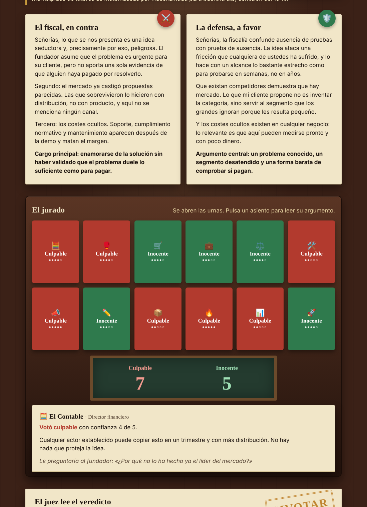

# Jurado de Claudes

**12 Claudes ponen tu idea a juicio.**

Claude, como casi cualquier asistente, tiende a darte la razón. Si le
preguntas por tu idea, te aplaude. Este proyecto lo hace discutir consigo
mismo: un sistema multiagente donde **15 instancias de Claude** con roles
distintos juzgan tu idea de negocio o proyecto y te devuelven una respuesta
honesta en vez de un aplauso.



## Cómo funciona el juicio

```
                 ┌──────────────┐
    tu idea ───► │  El Fiscal   │ ──► alegato en contra ─┐
                 └──────────────┘                        │
                 ┌──────────────┐                        │   (en paralelo)
    tu idea ───► │  El Defensor │ ──► alegato a favor  ──┤
                 └──────────────┘                        │
                                                         ▼
          ┌──────────────────────────────────────────────────────────┐
          │                 12 jurados, en paralelo y en secreto     │
          │  🧮 Contable   🥊 Competidor   🛒 Clienta   💼 Inversor  │
          │  ⚖️ Abogada    🛠️ Ingeniero    📣 Marketer  ✏️ Diseñadora│
          │  📦 Operaciones 🔥 Fundador quemado 📊 Analista 🚀 Early │
          │         cada uno vota CULPABLE o INOCENTE                │
          └──────────────────────────────────────────────────────────┘
                                                         │
                                                         ▼
                 ┌──────────────┐      CONSTRUIR / PIVOTAR / ARCHIVAR
                 │   El Juez    │ ──►  + lo que convence, lo que preocupa
                 └──────────────┘      + el siguiente paso para esta semana
```

1. **El fiscal** construye el caso en contra: supuestos frágiles, riesgos,
   lo que el mercado ya castigó antes.
2. **El defensor** construye el mejor caso a favor, sin exagerar.
3. **Doce jurados**, cada uno con un oficio distinto (contable, competidor
   directo, clienta escéptica, inversor, abogada…), leen la idea y los dos
   alegatos y emiten una **papeleta secreta**. Ninguno ve el voto de los
   demás: votan todos a la vez.
4. **El juez** cuenta los votos y lee el veredicto: `CONSTRUIR` (8+ votos de
   inocencia), `ARCHIVAR` (8+ de culpabilidad) o `PIVOTAR` (jurado dividido),
   con lo que convence, lo que preocupa y una acción concreta para esta
   semana.

Cada agente es una llamada independiente a la API de Claude con su propio
prompt de sistema; están todos en [`jurado/agentes.py`](jurado/agentes.py)
y puedes cambiar los roles del jurado a tu gusto.

## Instalación

Necesitas Python 3.11 o superior y una clave de la API de Claude
([platform.claude.com](https://platform.claude.com/)).

```bash
git clone https://github.com/yort4581/jurado-de-claudes.git
cd jurado-de-claudes
python -m venv .venv && source .venv/bin/activate   # en Windows: .venv\Scripts\activate
pip install -r requirements.txt
cp .env.example .env            # y pon tu ANTHROPIC_API_KEY dentro
```

## Uso

### Sala de juicio en el navegador

```bash
uvicorn jurado.server:app --reload
```

Abre <http://127.0.0.1:8000>, escribe tu idea y pulsa **Abrir el juicio**.
Verás los alegatos, las doce papeletas entrando en la urna, la apertura de
las urnas y el sello del veredicto. Pulsa cualquier asiento para leer el
argumento de ese jurado y la pregunta que te haría.

### Desde la terminal

```bash
python -m jurado "Una app de suscripción para que restaurantes pequeños gestionen reservas por WhatsApp, 29 €/mes."
python -m jurado --json "…"   # solo el resultado, en JSON
python -m jurado              # pide la idea por teclado
```

### Desde tu propio código

```python
import asyncio
from jurado import juzgar

juicio = asyncio.run(juzgar("Tu idea aquí"))
print(juicio.inocentes, "inocentes,", juicio.culpables, "culpables")
print(juicio.veredicto.decision, "-", juicio.veredicto.siguiente_paso)
```

`celebrar_juicio(idea)` es la versión en streaming: un generador asíncrono
que emite un evento por agente (`apertura`, `fiscal`, `defensor`,
`papeleta` ×12, `recuento`, `veredicto`, `fin`). El servidor web lo reenvía
tal cual por *server-sent events* (`POST /api/juicio`).

### Probar sin gastar tokens

```bash
JURADO_MOCK=1 uvicorn jurado.server:app
JURADO_MOCK=1 python -m jurado "…"
```

En modo simulado no se llama a la API: los agentes devuelven respuestas de
prueba con algo de azar, útiles para tocar la interfaz o hacer una demo.

## Configuración

| Variable | Por defecto | Qué hace |
|---|---|---|
| `ANTHROPIC_API_KEY` | — | Tu clave de la API de Claude. |
| `JURADO_MODELO_PRINCIPAL` | `claude-sonnet-5-5` | Modelo del fiscal, el defensor y el juez. |
| `JURADO_MODELO_JURADO` | `claude-haiku-5-5` | Modelo de los 12 jurados (barato y rápido, porque son muchos). |
| `JURADO_MAX_PARALELO` | `6` | Máximo de llamadas simultáneas a la API. |
| `JURADO_MOCK` | `0` | `1` para el modo simulado. |
| `JURADO_CLAVE_ACCESO` | — | Si la defines, la web la pide antes de abrir un juicio. |

Un juicio completo son 15 llamadas. Con los modelos por defecto cuesta del
orden de un par de céntimos; si quieres un jurado más afilado, sube
`JURADO_MODELO_JURADO` a `claude-sonnet-5-5`.

## Publicar en internet (Render)

[](https://render.com/deploy?repo=https://github.com/yort4581/jurado-de-claudes)

El repositorio incluye [`render.yaml`](render.yaml). Al pulsar el botón,
Render pide dos valores: tu `ANTHROPIC_API_KEY` y una `JURADO_CLAVE_ACCESO`
inventada por ti. Ponla siempre: sin ella, cualquiera con el enlace podría
gastar tu saldo de la API. Comparte la clave solo con quien quieras que use
el tribunal.

## Estructura

```
jurado/
  agentes.py   # los 12 jurados, el fiscal, el defensor y el juez (prompts)
  llm.py       # llamada a la API de Claude + modo simulado
  juicio.py    # orquestación: alegatos en paralelo, votación secreta, veredicto
  server.py    # FastAPI: sirve la web y transmite el juicio por SSE
  cli.py       # juicio en la terminal
web/index.html # la sala de juicio
tests/         # pruebas del flujo completo en modo simulado (pytest)
```

## Pruebas

```bash
python -m pytest
```

## Créditos

Inspirado en la idea de [@revolutia.ai](https://www.tiktok.com/@revolutia.ai)
de poner a doce Claudes a juzgar una idea en vez de preguntarle a uno solo.
Construido con la [API de Claude](https://platform.claude.com/) de Anthropic.

Licencia MIT.
